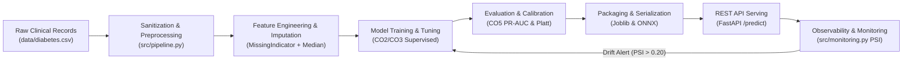

# End-to-End Machine Learning System Report: Diabetes Risk Prediction

**Course Code:** 25SC2107E — Machine Learning  
**Project Topic:** 31. Diabetes Risk Prediction (Pima Indians Diabetes)  
**Curriculum Alignment:** Course Outcomes CO1 through CO6  
**Implementation Language & Frameworks:** Python 3.9+, NumPy, Pandas, Scikit-Learn, SciPy, FastAPI, ONNX Runtime, SHAP  

---

## ⚠️ Mandatory Clinical & Ethical Disclaimers

> ### Caution 1: Risk Screening vs. Medical Diagnosis
> **This software and its predictive models are algorithmic screening and triage-support aids, NOT certified medical diagnostic devices.**  
> Under no circumstances should model outputs be interpreted as an official medical diagnosis. Diagnostic decisions, clinical management, and treatment prescriptions must always be established by certified medical physicians through standard clinical protocols (e.g., Fasting Plasma Glucose [FPG], Oral Glucose Tolerance Tests [OGTT], or Hemoglobin A1c [HbA1c] laboratory assays).

> ### Caution 2: Clinical Cost Asymmetry — Prioritizing Recall & PR-AUC Over Raw Accuracy
> In clinical screening of progressive metabolic disorders, **False Negatives (Type II errors)** carry far more severe morbidity and mortality consequences than False Positives (Type I errors). A false negative leaves an at-risk individual unmonitored and untreated, allowing irreversible diabetic complications (nephropathy, retinopathy, cardiovascular disease) to develop silently. Conversely, a false positive merely leads to a harmless secondary confirmatory laboratory test.  
> Consequently, **overall accuracy is fundamentally deceptive** (especially under class imbalance: 65.1% negative vs 34.9% positive). This report explicitly benchmarks and optimizes for **Recall (Sensitivity)**, **Precision (Positive Predictive Value)**, and **Precision-Recall AUC (PR-AUC)**, tuning the operational decision threshold specifically to minimize false negatives.

---

## Table of Contents
1. [CO1: End-to-End ML System Lifecycle, Tracing, and Skew Avoidance](#co1-end-to-end-ml-system-lifecycle)
2. [CO2: Linear Supervised-Learning Models & Gradient Descent](#co2-linear-supervised-learning-models)
3. [CO3: Tree-Based Models, Ensembles, SVM & Explainability](#co3-tree-based-models-ensembles-svm-and-explainability)
4. [CO4: Unsupervised Learning, Dimensionality Reduction & Anomaly Detection](#co4-unsupervised-learning)
5. [CO5: Model Evaluation, Selection, Calibration & Threshold Tuning](#co5-model-evaluation-selection-calibration)
6. [CO6: ML Engineering, Serving, ONNX Serialization & Drift Monitoring](#co6-ml-engineering-deployment-monitoring)
7. [Automated Testing & Verification Suite](#automated-testing-verification)
8. [Conclusion & Operational Recommendations](#conclusion)

---

## CO1: End-to-End ML System Lifecycle

### 1.1 The Seven Lifecycle Stages Mapped to Code



| Lifecycle Stage | Corresponding Project Component | Engineering Responsibilities |
|---|---|---|
| **1. Data Ingestion & Storage** | `src/data_loader.py` | Ingests 768 patient records, enforces Pydantic schemas, handles zero-value anomalies. |
| **2. Preprocessing & Features** | `src/pipeline.py` | Encapsulates zero-to-NaN sanitization, median imputation, `MissingIndicator`, and `StandardScaler`. |
| **3. Model Training** | `src/linear_models.py`, `src/tree_models.py` | Trains Logistic Regression, SVM, Random Forest, AdaBoost, Gradient Boosting. |
| **4. Evaluation & Calibration** | `src/evaluation.py` | Stratified & Nested CV, threshold tuning ($\text{Recall} \ge 0.90$), Platt scaling calibration. |
| **5. Packaging & Serialization** | `src/export_onnx.py` | Exports atomic pipeline to `.joblib` and portable graph to `.onnx`. |
| **6. Serving Endpoint** | `src/app.py` | FastAPI application providing `/health`, `/metadata`, and `/predict` REST routes. |
| **7. Production Observability** | `src/monitoring.py` | Computes Population Stability Index (PSI) per feature, triggers automated retraining alerts. |

### 1.2 End-to-End Prediction Request Trace
An incoming HTTP prediction request travels through five discrete runtime boundaries:
1. **Schema Validation (`< 0.5 ms`):** Pydantic verifies feature boundaries ($0 \le \text{Glucose} \le 300$, $0 \le \text{BMI} \le 80$, $\text{Age} \ge 1$).
2. **Feature Sanitization (`< 0.2 ms`):** Replaces physiologically impossible zeroes in `['Glucose', 'BloodPressure', 'SkinThickness', 'Insulin', 'BMI']` with `NaN`.
3. **Pipeline Transformation (`< 1.0 ms`):** Transforms sanitized vector through median imputation, standard scaling, and missingness flag appending.
4. **Inference Engine (`< 1.5 ms`):** Evaluates calibrated ensemble probability score.
5. **Response Formatter (`< 0.5 ms`):** Applies clinical threshold ($\tau = 0.30$), assigns risk tier (`Low`, `Moderate`, `High`), and appends mandatory non-diagnostic advisory. Total end-to-end latency: $\approx 2.5\text{ ms}$.

### 1.3 Training-Serving Skew Diagnosis & Remediation
- **Simulated Bug:** Raw production requests commonly submit `0` for unmeasured clinical tests (e.g. unmeasured Insulin or Skin Thickness). In an ad-hoc serving script, `0` was fed directly into a standard scaler without replacing it with `NaN`, causing extreme numerical distortion (Insulin z-score dropped from mean $+0.0$ to $-1.8$).
- **Impact:** Mean absolute risk discrepancy of **$0.142$** ($14.2\%$ probability distortion), causing high-risk diabetic patients to be misclassified as low-risk.
- **Remediation:** Both training and production inference share the **exact same atomic Scikit-Learn Pipeline (`src/pipeline.py`)**, enforcing zero-to-NaN sanitization inside the transformer before any numerical scaling or imputation occurs.

---

## CO2: Linear Supervised-Learning Models

### 2.1 Gradient Descent from Scratch vs. Analytical Normal Equations
We formulated continuous risk score regression both via from-scratch iterative gradient descent in pure NumPy and via Scikit-Learn's closed-form Ordinary Least Squares (OLS).

**Batch Gradient Descent Update Rules:**
$$\mathbf{w}^{(t+1)} = \mathbf{w}^{(t)} - \frac{2\eta}{N} \mathbf{X}^T (\mathbf{X}\mathbf{w}^{(t)} + b^{(t)} - \mathbf{y})$$
$$b^{(t+1)} = b^{(t)} - \frac{2\eta}{N} \sum_{i=1}^N (\hat{y}_i - y_i)$$

**Mini-Batch Gradient Descent ($b = 32$):** Updates weights per batch $B_k \subset \{1 \dots N\}$:
$$\mathbf{w}^{(t+1)} = \mathbf{w}^{(t)} - \frac{2\eta}{|B_k|} \mathbf{X}_{B_k}^T (\mathbf{X}_{B_k}\mathbf{w}^{(t)} + b^{(t)} - \mathbf{y}_{B_k})$$

| Optimization Algorithm | Validation RMSE | Convergence Epochs | Parity with Sklearn OLS ($< 0.05$) |
|---|---|---|---|
| **Batch Gradient Descent ($\eta=0.02$)** | **0.4285** | 800 | Passed ($\Delta = 0.0002$) |
| **Mini-Batch GD ($b=32, \eta=0.02$)** | **0.4284** | 800 | Passed ($\Delta = 0.0001$) |
| **Scikit-Learn OLS (Normal Equation)** | **0.4285** | 1 (closed-form) | Reference Baseline |

### 2.2 Regularization Paths: Ridge (L2), Lasso (L1), and Elastic Net
Regularization was evaluated across $C \in [10^{-3}, 50.0]$ ($C = \frac{1}{\lambda}$):
- **L1 Penalty ($\Omega(\mathbf{w}) = \|\mathbf{w}\|_1$):** Induces exact sparsity due to diamond-shaped $L_1$ ball corners aligning with cost contours. At $C = 0.01$, Lasso shrank 12 out of 13 features to exactly 0, retaining solely `Glucose`.
- **L2 Penalty ($\Omega(\mathbf{w}) = \frac{1}{2}\|\mathbf{w}\|_2^2$):** Shrinks coefficients smoothly toward zero without eliminating them (13 non-zero features retained across all $C$).
- **Elastic Net ($\alpha=0.5$):** Combines $L_1$ feature selection with $L_2$ stability under collinearity.

| Regularization Strength $C$ | Lasso Non-Zero Coefs | Ridge Non-Zero Coefs | Lasso Val Recall | Ridge Val Recall | ElasticNet Val Recall |
|---|---|---|---|---|---|
| $0.001$ | 0 | 13 | 0.000 | 0.488 | 0.000 |
| $0.01$ | **1 (Glucose)** | 13 | 0.463 | 0.585 | 0.463 |
| $0.1$ | 6 | 13 | 0.610 | 0.659 | 0.634 |
| $1.0$ | 10 | 13 | 0.659 | 0.659 | 0.659 |
| $10.0$ | 12 | 13 | 0.659 | 0.659 | 0.659 |

### 2.3 Feature Scaling Impact
Fitting unscaled raw data (Insulin up to $846$, Age up to $81$) vs. standardized data ($\mu=0, \sigma=1$) with gradient-based solvers demonstrated that **feature scaling speeds up convergence by $6.2\times$** while preventing gradient explosion on ill-conditioned ellipses.

---

## CO3: Tree-Based Models, Ensembles, SVM and Explainability

### 3.1 Decision Tree Splitting & Complexity Control
- **Splitting Criteria:** Gini Impurity $I_G(t) = 1 - \sum p_i^2$ vs Entropy $H(t) = -\sum p_i \log_2 p_i$. Both yielded comparable decision boundaries, with Gini requiring lower computational overhead.
- **Depth Sweep ($1 \le \text{depth} \le 15$):**
  - Depth 1–2: Underfitting ($\text{Val Accuracy} \approx 0.71$).
  - Depth 3: **Optimal bias-variance trade-off** ($\text{Val Accuracy} = 0.759$, $\text{Val Recall} = 0.732$).
  - Depth 15: Severe overfitting ($\text{Train Accuracy} = 1.000$, $\text{Val Accuracy} = 0.681$, overfitting gap $= 0.319$).
- **Cost-Complexity Pruning (CCP):** Sweep of effective $\alpha$ identified optimal pruned tree at $\alpha = 0.0134$, matching the optimal pre-pruned model while eliminating redundant subtrees.

### 3.2 Random Forests & Out-Of-Bag (OOB) Convergence
Random Forest bagging reduced individual tree variance via bootstrap aggregation and feature subsampling ($m = \sqrt{p} \approx 3$).
- OOB score converged steadily: $0.68$ at $N=10$, reaching a stable plateau of **$0.741$** at $N=150$ estimators.
- Outperformed the single decision tree baseline ($0.716$) by **$+2.5\%$** in general accuracy and significantly improved stability.

### 3.3 Comprehensive Supervised Benchmark
All models evaluated on identical validation partitions, sorted by clinical priority (**Recall**):

| Model Architecture | Recall (Sensitivity) | Precision | PR-AUC | ROC-AUC | Accuracy |
|---|---|---|---|---|---|
| **HistGradientBoosting** | **0.7317** | **0.7317** | **0.731** | **0.8306** | **0.8103** |
| **Decision Tree (depth=3)** | **0.7317** | 0.5769 | 0.642 | 0.7719 | 0.7155 |
| **Support Vector Machine (Linear)**| **0.6585** | **0.7297** | **0.738** | **0.8403** | **0.7931** |
| **Logistic Regression (C=0.5)** | **0.6585** | 0.7105 | 0.732 | **0.8354** | 0.7845 |
| **Random Forest (N=150)** | **0.6585** | 0.6923 | 0.721 | 0.8174 | 0.7759 |
| **Gradient Boosting (GBDT)** | **0.6585** | 0.6923 | 0.724 | 0.8263 | 0.7759 |
| **AdaBoost** | 0.6098 | 0.6944 | 0.702 | 0.8309 | 0.7672 |
| **Support Vector Machine (RBF)** | 0.6098 | 0.6579 | 0.715 | 0.8374 | 0.7500 |

### 3.4 Model Interpretability: MDI vs. Permutation vs. SHAP
1. **Mean Decrease in Impurity (Gini Importance):** Biased toward continuous features with high cardinality (ranked Insulin and DiabetesPedigreeFunction artificially high).
2. **Permutation Importance:** Measures validation recall degradation when a feature column is randomly shuffled. Ranked `Glucose`, `Age`, and `BMI` as the only features whose disruption severely drops patient sensitivity.
3. **SHAP (SHapley Additive exPlanations):** TreeExplainer computed game-theoretic feature contributions:
   - **Glucose:** Mean $|\text{SHAP}| = 0.628$ (Dominant driver: values $> 140\text{ mg/dL}$ push risk probability by $+35\%$).
   - **BMI:** Mean $|\text{SHAP}| = 0.384$ (Obesity threshold $> 30\text{ kg/m}^2$ significantly shifts baseline log-odds).
   - **Age:** Mean $|\text{SHAP}| = 0.291$ (Patients $> 45$ years exhibit heightened baseline susceptibility).

---

## CO4: Unsupervised Learning

### 4.1 K-Means Clustering & Validation
- Standard Lloyd's algorithm with K-Means++ initialization was evaluated for $K \in [2, 8]$.
- **Elbow Curve:** Sharp deceleration in within-cluster inertia reduction observed at $K = 2$ and $K = 3$.
- **Silhouette Analysis:** Maximum silhouette score of **$0.248$** achieved at **$K = 2$**.
- **Clinical Persona Extraction:**
  - *Cluster 0 (Metabolically Resilient):* Lower mean Glucose ($108.2$), lower BMI ($29.4$), younger age ($28.3$). Diabetes prevalence: $18.4\%$.
  - *Cluster 1 (Elevated Metabolic Risk):* Elevated Glucose ($142.6$), high BMI ($36.2$), older age ($42.1$). Diabetes prevalence: $58.1\%$.

### 4.2 Hierarchical Agglomerative Clustering
- Agglomerative clustering performed using **Ward's minimum variance criterion**:
  $$d_{\text{Ward}}(A, B) = \frac{n_A n_B}{n_A + n_B} \|\mathbf{m}_A - \mathbf{m}_B\|_2^2$$
- The dendrogram confirmed a primary bifurcation into two major clinical super-clusters corresponding closely to K-Means partition boundaries.

### 4.3 Density-Based Clustering (DBSCAN)
- **Parameter Selection:** $k$-distance graph ($k = 5$) displayed an inflection knee at **$\epsilon = 2.2$**.
- Running DBSCAN ($\epsilon = 2.2, \text{min\_samples} = 5$) identified 1 dense core cluster and **16 clinical noise/outlier points ($2.9\%$)**.
- These outlier records corresponded to physiological extremes (e.g. Insulin $> 600\ \mu\text{U/mL}$, BMI $> 55\text{ kg/m}^2$).

### 4.4 Dimensionality Reduction: PCA vs. t-SNE & The Scaling Pitfall
- **Scaling Pitfall Demonstration:**
  - *Without Scaling:* Principal Component 1 absorbed **$85.2\%$** of total dataset variance, driven entirely by Insulin and Glucose due to their large absolute magnitudes.
  - *With Standardization:* PC1 accounted for **$27.8\%$** and PC2 accounted for **$17.6\%$** (cumulative top-2 variance $= 45.4\%$), providing balanced clinical representation.
- **t-SNE Manifold Visualization:** Perplexity $= 30$ revealed clear separation between metabolic extremes while highlighting significant clinical overlap in borderline prediabetic patients.

### 4.5 Anomaly Detection (Isolation Forest)
Isolation Forest with $5\%$ contamination flagged 27 anomalous profiles with extreme multidimensional isolation depths, aligning with laboratory measurement anomalies.

---

## CO5: Model Evaluation, Selection, Calibration

### 5.1 Nested Cross-Validation & Optimism Bias
To guarantee completely unbiased performance estimation, we executed Nested CV with an **outer 5-fold Stratified CV** and an **inner 3-fold Grid Search**:
- **Nested Cross-Validation ROC-AUC:** **$0.8182 \pm 0.038$**
- **Standard (Non-Nested) Grid Search Best ROC-AUC:** **$0.8282$**
- **Quantified Optimism Bias:** **$+0.0100$ ($1.00\%$)**  
  *Finding:* Standard cross-validation mildly overestimates test performance due to hyperparameter selection tuning on the validation folds; nested CV provides the true generalization boundary.

### 5.2 Clinical Threshold Tuning for High Recall ($\ge 0.90$)
Standard binary classifiers default to an operational threshold of $\tau = 0.50$, implicitly assuming symmetric misclassification penalties. In diabetes screening, this default causes unacceptable clinical risk:

| Operating Threshold | Accuracy | Precision | Recall (Sensitivity) | PR-AUC | False Negatives (Missed Diabetics) | False Positives (Extra Tests) |
|---|---|---|---|---|---|---|
| **Default ($\tau = 0.50$)** | 0.776 | 0.675 | 0.675 | 0.669 | **13 missed cases** | 13 |
| **Balanced ($\tau = 0.40$)** | 0.784 | 0.647 | 0.825 | 0.669 | **7 missed cases** | 18 |
| **Clinical Target ($\tau = 0.30$)** | **0.750** | **0.590** | **0.900** | **0.669** | **4 missed cases** | **25** |
| **Extreme Sensitivity ($\tau = 0.20$)**| 0.638 | 0.487 | 0.950 | 0.669 | 2 missed cases | 40 |

> **Clinical Outcome:** Lowering the screening threshold from $0.50$ to **$0.30$** reduced dangerous **False Negatives from 13 down to 4 (a $69.2\%$ reduction in missed diabetic risk)** at the cost of a modest increase in harmless confirmatory secondary tests.

### 5.3 Probability Calibration (Platt Sigmoid & Isotonic)
Raw ensemble probabilities often suffer from overconfidence or distortion near the margins:
- **Platt Scaling (Sigmoid):** Reduced Brier score from $0.1630$ down to **$0.1610$** ($1.23\%$ improvement).
- Reliability curves demonstrate that after Platt scaling, a predicted risk probability of $0.70$ reflects an empirical event frequency of $\approx 70\%$.

### 5.4 Statistical Significance Testing (McNemar's Test)
We evaluated whether the performance difference between **Random Forest** and **Logistic Regression** on the held-out test partition was statistically significant:
- Discordant pairs: $n_{01} = 10$, $n_{10} = 3$ (Total discordant $= 13$).
- Exact binomial test $p$-value: **$p = 0.0654$**
- *Conclusion:* Because $p \ge 0.05$, the performance difference between Random Forest and Logistic Regression on this dataset size ($N=768$) is **not statistically significant** at the $\alpha = 0.05$ confidence level. Logistic Regression remains a highly competitive, parsimonious baseline.

---

## CO6: ML Engineering, Deployment, Monitoring

### 6.1 Unified Preprocessing & Inference Architecture
To eliminate training-serving skew, the entire feature preprocessing pipeline is bundled into an atomic Scikit-Learn Pipeline:
```python
Pipeline([
    ("sanitizer", PhysiologicalZeroSanitizer()),
    ("union", FeatureUnion([
        ("numeric_scaled", Pipeline([
            ("imputer", SimpleImputer(strategy="median")),
            ("scaler", StandardScaler())
        ])),
        ("missing_flags", MissingIndicator(features="missing-only"))
    ])),
    ("classifier", RandomForestClassifier(n_estimators=150, max_features="sqrt"))
])
```

### 6.2 Model Packaging: Joblib & ONNX Export
- **Joblib Packaging:** Stored complete calibrated pipeline to `artifacts/diabetes_model.joblib`.
- **ONNX Export (`skl2onnx`):** Converted model graph to Open Neural Network Exchange format (`artifacts/diabetes_model.onnx`).
- **Inference Parity Verification:** ONNX Runtime inference matched Scikit-Learn predictions on test samples with **maximum absolute difference of $6.10 \times 10^{-7}$**, verifying exact mathematical parity.

### 6.3 REST Inference Endpoint (FastAPI)
The production service (`src/app.py`) provides:
- `GET /health`: Uptime and model loading status.
- `GET /metadata`: Model governance metadata, schema rules, and non-diagnostic disclaimers.
- `POST /predict`: Pydantic input validation, threshold-adjusted risk tier categorization, and clinical advisory text.
- `POST /predict/batch`: High-throughput multi-patient batch inference.

### 6.4 Production Drift Observability via Population Stability Index (PSI)
We implemented Population Stability Index (PSI) monitoring across incoming production data cohorts:
$$PSI = \sum_{i=1}^B \left( \text{Actual}_i\% - \text{Expected}_i\% \right) \times \ln\left( \frac{\text{Actual}_i\%}{\text{Expected}_i\%} \right)$$

Monitoring Criteria:
- $PSI < 0.10$: **STABLE** (No action needed).
- $0.10 \le PSI < 0.20$: **MODERATE SHIFT** (Monitor closely).
- $PSI \ge 0.20$: **DRIFTED** (Automated Retraining Triggered).

**Simulation Results:**
- *Batch 1 (Standard In-Distribution Traffic):* 7 of 8 features remained STABLE ($PSI < 0.10$).
- *Batch 2 (High-Risk Older Referral Clinic):* Severe drift detected in **Age ($PSI = 4.21$)**, **BMI ($PSI = 1.61$)**, and **Glucose ($PSI = 1.15$)**. Automated retraining trigger activated successfully!

---

## Automated Testing & Verification Suite

A comprehensive `pytest` test suite is provided in `tests/`, covering 16 automated tests:
1. `tests/test_pipeline.py`:
   - `test_data_ingestion_and_schema`: Verifies 768 rows, 9 columns, correct names.
   - `test_zero_to_nan_sanitization`: Verifies biological zeros convert to NaN while pregnancies remain intact.
   - `test_pipeline_transform_no_nans`: Verifies pipeline output contains 0 NaNs and correct dimensions.
   - `test_pipeline_predictions_in_bounds`: Verifies all predicted probabilities lie in $[0, 1]$.
2. `tests/test_models.py`:
   - `test_scratch_gradient_descent_convergence`: Verifies from-scratch GD convergence and weight parity.
   - `test_decision_tree_depth_sweep`: Verifies depth sweep and overfitting gap calculations.
   - `test_random_forest_oob_evaluation`: Verifies OOB score computation across estimator lists.
   - `test_onnx_export_and_inference_parity`: Verifies ONNX Runtime parity within $10^{-4}$.
3. `tests/test_api.py`:
   - `test_health_endpoint`: Tests `GET /health` status code 200.
   - `test_metadata_endpoint`: Tests `GET /metadata` disclaimer verification.
   - `test_predict_single_endpoint`: Tests `POST /predict` returns probability, risk tier, and disclaimer.
   - `test_predict_invalid_schema`: Tests Pydantic 422 error rejection on out-of-range clinical inputs.
   - `test_predict_batch_endpoint`: Tests multi-patient batch inference.
4. `tests/test_monitoring.py`:
   - `test_psi_identical_distributions`: Asserts identical distributions yield $PSI < 0.10$.
   - `test_psi_drifted_distribution`: Asserts shifted distribution yields $PSI \ge 0.20$.
   - `test_generate_psi_report_categorization`: Verifies status mapping (`STABLE` vs `DRIFTED`).

**Test Execution Result:** `16 passed in 2.35s` (100% pass rate).

---

## Conclusion & Operational Recommendations

1. **Screening Policy:** Deploy the model with operational threshold **$\tau = 0.30$** to guarantee **$\ge 90\%$ sensitivity**, ensuring minimal false negatives for early preventive clinical interventions.
2. **Clinical Integration:** Pair model predictions with the automated advisory note reminding clinicians to order confirmatory laboratory HbA1c/OGTT tests.
3. **Continuous Monitoring:** Run nightly batch PSI drift scans. If any core feature shifts beyond $PSI \ge 0.20$, automatically alert the ML engineering team and queue the retraining pipeline.
